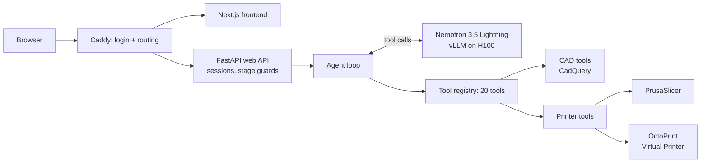

# Shim

**A small model that designs a demonstration prosthetic socket and prints it, by choosing its own tools.**

Built for the NVIDIA x Red Hat Small Models Hack, Tool-Calling track.

You describe what you want in plain language ("make the residual length 150 mm", "thicken the wall to 6 mm", "engrave SHIM-04 on the front", "print a 40% preview"). **Nemotron 3.5 Lightning** picks from 20 tools we built and optimized for the purpose of prosthetics engineering to edit the CAD model, check it, slice it and send it to a 3D printer. The model never edits geometry or drives the printer directly. Deterministic Python tools do the work, check every argument, and refuse with a reason and a valid range when something is out of bounds; the model then corrects itself or asks you.

- **Live demo:** https://8080-bbr7fjhsb.gobrev.dev (username and password: `shim`), while the Brev instance is running (it will be running through the judging period for judges convenience).
- **Flow:** residual limb → socket → printer, three pages with the same agent on each.
- **Safety in code, not just the prompt:** a part must pass `validate_part` before it can be sliced, nothing prints without your approval, and a print is reported as started only once the printer confirms it.

> Demonstration only. The limb is synthetic and the parts are not wearable. A passing check is a geometry check, not a clinical fit or safety check.

## Quick start

**Fastest look, no backend:** the web app runs on built-in mock data.

```bash
npm --prefix agent/ui/web install
```

```bash
npm --prefix agent/ui/web run dev
```

Open http://localhost:3000.

**Full stack, locally** (needs Python 3.12, [uv](https://docs.astral.sh/uv/), Node 20+, [PrusaSlicer](https://www.prusa3d.com/prusaslicer/), and Nemotron served by vLLM; see [Reproducing the demo](#reproducing-the-demo)):

```bash
uv sync && npm --prefix agent/ui/web install && uv tool install octoprint
```

```bash
cp sample.env .env
```

In `.env`, set `OCTOPRINT_API_KEY` to any random string, and point `VLLM_BASE_URL` / `VLLM_API_KEY` at your model server. Then run each of these in its own terminal:

```bash
scripts/octoprint/start.sh
```

```bash
FAKE_TOOLS=0 uv run uvicorn agent.web_api:app --port 8001
```

```bash
NEXT_PUBLIC_USE_MOCK=0 npm --prefix agent/ui/web run dev
```

Open http://localhost:3000. Run the tests with `uv run pytest`; they need no model.

**Everything on one GPU box (how the live demo runs):** `deploy/sync.sh`, then `deploy/setup.sh` once and `deploy/start.sh <public-url>` on the instance. See [docs/RUNNING.md](docs/RUNNING.md#hosting-everything-on-brev).

## Tech stack and architecture

| Layer | Technology |
|---|---|
| Model | NVIDIA Nemotron 3.5 Lightning (30B total, 3B active), served by **vLLM** with the `qwen3_coder` tool-call parser, on an H100 (Brev) |
| Agent | Python agent loop with a JSON-schema tool registry and a shared result type (`success` / `fixable` / `fatal`) |
| Backend | FastAPI, with agent turns streamed as server-sent events |
| CAD | CadQuery / OpenCascade: parametric limb, socket, adapter, pylon and foot |
| Printing | PrusaSlicer CLI, then OctoPrint and its Virtual Printer |
| Frontend | Next.js 16, React 19, three.js (react-three-fiber), Tailwind |
| Hosting | One Brev instance behind Caddy (login, routing, streaming) |



**How one request flows:** the model returns a tool call; the registry checks the arguments against the tool's schema; the web API's guard enforces the workflow (for example, printing only the confirmed socket, or only your own job); the tool runs and returns a typed result; and the model decides what to do next. Pauses for your answer or approval come from two built-in tools, `ask_user` and `request_confirmation`. Moving between pages comes from a third, `move_to_stage`.

**Tools the model can call:**
- **Limb:** `inspect_limb_template`, `validate_measurements`, `customize_residual_limb`
- **Socket:** `create_part`, `inspect_part`, `modify_socket`, `fit_socket_to_limb`, `check_fit`, `engrave_label`, `validate_part`, `list_parts`
- **Lower leg:** `modify_component`, `assemble_prosthesis`
- **Printing:** `make_preview_print`, `prepare_print`, `slice`, `get_printer_status`, `start_print`, `get_job_progress`, `cancel_print`

## Reproducing the demo

1. **Serve the model.** On a GPU with 80 GB (we used one H100 on Brev):

   ```bash
   sudo docker run --rm --gpus all --ipc=host -p 8000:8000 -v ~/.cache/huggingface:/root/.cache/huggingface vllm/vllm-openai:v0.27.1 --model nvidia/NVIDIA-Nemotron-3.5-Lightning-30B-A3B-BF16 --served-model-name NVIDIA-Nemotron-3.5-Lightning-30B-A3B --enable-auto-tool-choice --tool-call-parser qwen3_coder --reasoning-parser nemotron_v3 --max-model-len 65536 --max-num-seqs 256 --api-key "$VLLM_API_KEY"
   ```

   `--max-num-seqs 256` is needed on an H100. Drop `--api-key` for a server only you can reach. From a laptop, `scripts/brev/tunnel.sh <instance>` forwards it to `localhost:8000`.
2. **Set the environment.** Copy `sample.env` to `.env`. The API keys are ones you create yourself; no third-party paid API is used.

   | Variable | Example | Purpose |
   |---|---|---|
   | `VLLM_BASE_URL` | `http://localhost:8000/v1` | vLLM's OpenAI-compatible endpoint |
   | `VLLM_API_KEY` | *(your key, or empty)* | Must match vLLM's `--api-key` |
   | `MODEL_NAME` | `NVIDIA-Nemotron-3.5-Lightning-30B-A3B` | The served model name |
   | `OCTOPRINT_URL` | `http://localhost:5001` | Local OctoPrint |
   | `OCTOPRINT_API_KEY` | *(any random string)* | `scripts/octoprint/start.sh` writes it into OctoPrint's config |
   | `FAKE_TOOLS` | `0` | `1` swaps the printer for an instant fake (the CAD tools stay real) |
   | `PRUSASLICER_BIN` | *(optional)* | Slicer path, if `prusa-slicer` isn't on `PATH` |
   | `SHIM_PASSWORD` | `shim` | Site password, used only behind Caddy (`deploy/start.sh`) |
   | `NEXT_PUBLIC_USE_MOCK` | `0` | Frontend: `0` uses the API, anything else uses mock data |
   | `NEXT_PUBLIC_API_BASE` | `http://localhost:8001/api` | Frontend: where the API is |

3. **Start OctoPrint, the API and the web app** as in [Quick start](#quick-start).
4. **Run the demo flow:**
   - **Limb page:** "set the residual length to 150 mm and P to 300 mm", then **Confirm limb**.
   - **Socket page:** "make the wall 6 mm", then "engrave SHIM-01 on the front", "validate it", and **Confirm socket**. Try "set the depth to 140 mm" to watch a refusal and recovery.
   - **Printer page:** "make a 40% preview and print it with the draft profile", then approve in the dialog. The live layer view follows the print.

   The scripted version with talking points is in [docs/DEMO_SCRIPT.md](docs/DEMO_SCRIPT.md).

## Data and provenance

- **No patient data, and no external dataset in the running system. All of the data comes from the live MCP connections to a real or virtual 3D Printer and the CAD software.**
- **Residual limb:** a **fully synthetic, hand-authored parametric profile**, [`data/profiles/standard_limb.json`](data/profiles/standard_limb.json), model id `synthetic-transtibial-standard`. It holds a 140 mm length and elliptical cross-sections at set stations, and [`tools/cad/generate_limb.py`](tools/cad/generate_limb.py) revolves it into a closed solid. Your measurements resize this one standard shape; they don't reconstruct anyone's anatomy.
- **Socket:** [`data/profiles/standard_socket.json`](data/profiles/standard_socket.json), a parametric shell built around the limb with a set clearance, wall and depth.
- **Reference files:** [`data/reference/`](data/reference) holds the STEP/STL files and validation reports generated from those two profiles.
- **Lower leg:** the adapter, pylon and foot are parametric demonstration parts defined in [`tools/cad/prosthesis.py`](tools/cad/prosthesis.py).
- **OpenLimbTT:** the original plan used the [OpenLimbTT](https://github.com/abel-research/OpenLimbTT) dataset (`2025-07`) as the limb shape. It is **not** used or included in the build; see the long design document.

## Known limitations

- **The limb is not anatomy.** It's one parametric shape resized by length, three circumferences and an optional AP/ML width. The distal circumference can't exceed the proximal one, and side, posture and distal shape are recorded but don't change the geometry.
- **Checks are geometric only:** closed solid, wall thickness, opening and dimensions. There's no fit, comfort, load or clinical validation.
- **One shared virtual printer.** There's no queue: a second print request is told to try again in about N minutes. A full-size socket takes about 11 h, which is why the demo prints a scaled preview.
- **The lower leg is display only.** It always uses the standard adapter, pylon and foot, and is never printed. The adapter's flat plate leaves a gap under the socket's rounded end.
- **Sessions live in memory,** on a single API worker. Restarting the API resets every session and sign-in.
- **The small model sometimes retries values on its own** before asking. The tool code bounds this (at most 3 fixable errors in a row, ranges in every refusal), but it shows up in traces.
- **On Linux the slicer is PrusaSlicer 2.8.1,** the last Linux AppImage. It slices our 2.9 profiles with matching estimates.

## Next steps

- Replace the synthetic limb with a statistical shape model (OpenLimbTT) or a scanned limb, keeping the same tool interface.
- More socket features through the same feature layer: vent holes, trim lines, relief zones, all reviewed with a clinician.
- An evaluation set for tool calls: correct tool, correct arguments, recovery after a refusal, measured per model.
- A print queue and persistent sessions, and a physical printer behind OctoPrint.
- Component edits (pylon length, foot size) shown in the 3D view, not just in the assembly tool.

## More documentation

| Document | Contents |
|---|---|
| [docs/README_LONG.md](docs/README_LONG.md) | The full design document: research, rationale, safety rules (long) |
| [docs/RUNNING.md](docs/RUNNING.md) | Running every piece, troubleshooting, Brev hosting |
| [docs/FRONTEND_API.md](docs/FRONTEND_API.md) | The web API contract |
| [docs/DEMO_SCRIPT.md](docs/DEMO_SCRIPT.md) | Demo script and talking points |
| [docs/STRUCTURE.md](docs/STRUCTURE.md) | Folder layout |
