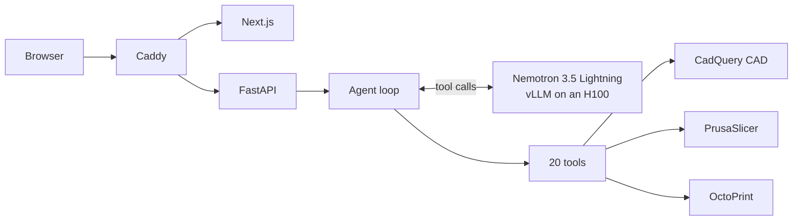

# Shim

From a tape measurement to a 3D-printed prosthetic socket, by talking to a small model.

We built Shim for the NVIDIA x Red Hat Small Models Hack (Tool-Calling track). You tell it what you want, for example "make the residual length 150 mm", "thicken the wall to 6 mm", "engrave SHIM-04 on the front" or "print a 40% preview", and **Nemotron 3.5 Lightning** works out which of our tools to call to change the CAD model, check it, slice it and send it to a printer.

The model never touches geometry or the printer directly. Our Python tools do the actual work, check every argument, and refuse with a reason and a valid range when something's off. The model reads the refusal and fixes its call, or asks you. Nothing prints until you approve it.

**Try it:** https://8080-bbr7fjhsb.gobrev.dev (password `shim`). We're keeping it running through judging.

> This is a demo. The limb is synthetic and the parts aren't wearable. When a check passes, it's a geometry check, not a clinical fit.

## What it does

The app follows the same steps a prosthetist would, on three pages, with one agent you can talk to throughout:

1. **Residual limb.** Start from our standard limb and ask for the measurements you want. The agent validates them and rebuilds the limb.
2. **Socket.** Confirming the limb builds a socket around it. Ask for changes (wall, depth, opening, an engraved label), see the limb seated inside it, and toggle the adapter, pylon and foot underneath.
3. **Printer.** The agent slices the socket (it asks which profile), shows the time and filament, and waits for your approval. Then it prints on OctoPrint and reports progress read back from the printer, including a live layer-by-layer view. Short on time? Ask for a scaled preview: about 70 minutes instead of 11 hours.

## How it works



| Part | What we used |
|---|---|
| Model | NVIDIA Nemotron 3.5 Lightning (30B total, 3B active), served by vLLM on an NVIDIA H100 via Brev |
| Agent | A plain Python loop, a JSON-schema tool registry, and one result type for every tool: `success`, `fixable` or `fatal` |
| Backend | FastAPI, streaming each agent turn to the page |
| CAD | CadQuery / OpenCascade, with every edit saved as a new revision |
| Printing | PrusaSlicer, then OctoPrint and its Virtual Printer |
| Frontend | Next.js 16, React 19, three.js |
| Hosting | Everything on one Brev GPU instance, behind Caddy |

**How one step works:**
1. The model returns a tool call.
2. The registry checks the arguments against the tool's schema.
3. The API's guard checks it against the workflow: it must use the current limb, print only the confirmed socket, and touch only your own print job.
4. The tool runs and returns a typed result.
5. The model decides what to do next.

Nothing forces the order. If the model tries to slice an unchecked part, the tool says no.

**The 20 tools:**
- **Limb:** `inspect_limb_template`, `validate_measurements`, `customize_residual_limb`
- **Socket:** `create_part`, `inspect_part`, `list_parts`, `modify_socket`, `fit_socket_to_limb`, `check_fit`, `engrave_label`, `validate_part`
- **Lower leg:** `modify_component`, `assemble_prosthesis`
- **Printing:** `make_preview_print`, `prepare_print`, `slice`, `get_printer_status`, `start_print`, `get_job_progress`, `cancel_print`

There are three more built in to the loop: `ask_user`, `request_confirmation` and `move_to_stage`.

## Why Nemotron 3.5 Lightning

It's the only model in Shim, and it makes every decision: it reads the request, picks and chains the tools, recovers when one refuses, and explains the result. The tools do the geometry and the printing; Nemotron decides what happens and in what order.

**Why we chose it:**
- **Small enough to run where the work happens.** Sockets get made in clinics and small labs, and some of them have patchy internet, no budget for big hosted models, or patient data that can't leave the building.
- **Cheap per token.** Nemotron Lightning is a mixture-of-experts model with only 3B of its 30B parameters active per token, so it's fast and cheap to run.
- **One GPU, nothing external.** We run the whole system, model included, on one GPU with nothing sent to an outside API. In BF16 that's about 60 GB on an 80 GB card, with a 64K context.
- **A smaller copy next.** A 4-bit copy would be around 16–18 GB, small enough for a single workstation GPU. That's our next step, though we haven't tested it yet.
- **Clean tool calls.** It produces clean, structured tool calls through vLLM's `qwen3_coder` parser.

**How we got the most out of it:**
- **Serving:** vLLM with its tool-call and reasoning parsers, tuned to fit on one H100. Temperature 0.2, and the reply is never left empty.
- **Tools written for a small model:** flat typed arguments, short results instead of raw CAD reports, and every refusal says why, gives the valid range and suggests the next step.
- **Rules in code, not the prompt:**
  - a guard keeps it on the current limb, socket and print job;
  - three refusals in a row ends the attempt;
  - every turn starts with a note naming the current parts;
  - approvals are checked by the tools themselves, so the model can't skip them.

## What we built, and what we measured

- **It works end to end.** Limb → socket → slice → approval → print, live on the demo URL. 159 automated tests cover the tools, guards, agent loop and API without needing the model.
- **The model recovers instead of following a script.** Some things we watched it do:
  - **Asked for a 148 mm socket depth:** the tool refused, and the model explained the 148.5 mm minimum and offered that instead.
  - **Asked for a 4 mm-deep engraving:** it explained the 0.4–1.5 mm limit.
  - **Reached for a limb from an earlier session:** our guard named the current limb, and it retried with that.
- **It's fast where it matters:**
  - **Engraving:** we rewrote it from 90–200 s (and sometimes wrong) to about **4 s**.
  - **Slicing:** a full socket slices in about **3 s**.
  - **Layer view:** it indexes a 17 MB print file in **0.6 s**.
  - **Agent turns:** a simple turn with a tool call takes about **4–9 s**.
- **NVIDIA and Red Hat:**
  - Nemotron makes every call.
  - vLLM (the engine Red Hat ships as Red Hat AI Inference Server) serves it.
  - An NVIDIA H100 on NVIDIA Brev runs both the model and the entire app.
- **What we didn't do:** no fine-tuning, no multi-agent setup, and no formal evaluation set yet. This is a single-model tool-calling project.

## Quick start

**Just look around (no backend, mock data):**

```bash
npm --prefix agent/ui/web install && npm --prefix agent/ui/web run dev
```

Open http://localhost:3000.

**Run the real thing.** You'll need Python 3.12, [uv](https://docs.astral.sh/uv/), Node 20+, [PrusaSlicer](https://www.prusa3d.com/prusaslicer/) and the model served as below.

```bash
uv sync && npm --prefix agent/ui/web install && uv tool install octoprint && cp sample.env .env
```

In `.env`, set `OCTOPRINT_API_KEY` to any random string and point `VLLM_BASE_URL` / `VLLM_API_KEY` at your model. Then, each in its own terminal:

```bash
scripts/octoprint/start.sh
```

```bash
FAKE_TOOLS=0 uv run uvicorn agent.web_api:app --port 8001
```

```bash
NEXT_PUBLIC_USE_MOCK=0 npm --prefix agent/ui/web run dev
```

Tests: `uv run pytest`; they don't need the model. To host everything on one GPU box the way our demo runs, see [docs/RUNNING.md](docs/RUNNING.md#hosting-everything-on-brev).

## Reproducing the demo

**1. Serve the model** on an 80 GB GPU (we used an H100 on Brev):

```bash
sudo docker run --rm --gpus all --ipc=host -p 8000:8000 -v ~/.cache/huggingface:/root/.cache/huggingface vllm/vllm-openai:v0.27.1 --model nvidia/NVIDIA-Nemotron-3.5-Lightning-30B-A3B-BF16 --served-model-name NVIDIA-Nemotron-3.5-Lightning-30B-A3B --enable-auto-tool-choice --tool-call-parser qwen3_coder --reasoning-parser nemotron_v3 --max-model-len 65536 --max-num-seqs 256 --api-key "$VLLM_API_KEY"
```

You need `--max-num-seqs 256` on an H100. From a laptop, `scripts/brev/tunnel.sh <instance>` forwards it to `localhost:8000`.

**2. Fill in `.env`** (copied from [`sample.env`](sample.env)). Every key is one you make up yourself; no paid APIs.

| Variable | What it's for |
|---|---|
| `VLLM_BASE_URL`, `VLLM_API_KEY`, `MODEL_NAME` | Where the model is, its key (if vLLM has one), and its served name |
| `OCTOPRINT_URL`, `OCTOPRINT_API_KEY` | Local OctoPrint (port 5001) and the key `scripts/octoprint/start.sh` sets up |
| `FAKE_TOOLS` | `1` swaps in an instant fake printer; CAD stays real |
| `PRUSASLICER_BIN` | Only if `prusa-slicer` isn't on your `PATH` |
| `SHIM_PASSWORD` | The site password when hosted behind Caddy (default `shim`) |
| `NEXT_PUBLIC_USE_MOCK`, `NEXT_PUBLIC_API_BASE` | Frontend: `0` to use the real API, and where it is |

**3. Try this flow:**
- **Limb page:** "set the residual length to 150 mm and P to 300 mm", then **Confirm limb**.
- **Socket page:** "make the wall 6 mm", "engrave SHIM-01 on the front", "validate it", then **Confirm socket**. Ask for "a depth of 140 mm" to see a refusal and recovery.
- **Printer page:** "make a 40% preview and print it with the draft profile", then approve.

The full talk track is in [docs/DEMO_SCRIPT.md](docs/DEMO_SCRIPT.md).

## Data

We used **synthetic data we generated during the hackathon**, published with how we made it in [`data/README.md`](data/README.md).
- **The base:** a standard residual limb (140 mm long, five elliptical cross-sections) and a standard socket built around it. Both are stored as parameter files in [`data/profiles/`](data/profiles), with the generated STEP/STL files and validation reports in [`data/reference/`](data/reference).
- **How it's built:** CadQuery turns each profile into a closed solid, and a validator re-measures every section; the reference limb is within 0.001 mm of every target. Two commands regenerate the whole set.
- **Variants:** every measurement change in a session makes a new synthetic variant, saved as a revision with its parameters, so it can be rebuilt exactly.
- **Provenance:** no patient data and no external dataset. We considered starting from the open [OpenLimbTT](https://github.com/abel-research/OpenLimbTT) dataset, but this build doesn't use it.

## Limitations and next steps

**Limitations:**
- **The limb isn't anatomy.** It's one shape resized by length, three circumferences and optionally AP/ML width. The distal end can't be wider than the proximal end, and side, posture and distal shape are noted but don't change the geometry.
- **Checks are geometric only:** solid, dimensions, wall thickness, opening. Nothing here checks fit, comfort or load.
- **There's one shared virtual printer and no queue.** If it's busy, the agent tells you to try again in about N minutes.
- **The adapter, pylon and foot are for show:** always the standard parts, never printed.
- **Sessions live in memory,** so restarting the server resets them.
- **The model sometimes tries a couple of values on its own before asking.** The tools cap this at three refusals in a row.
- **On Linux we use PrusaSlicer 2.8.1** (the last Linux AppImage). It slices our 2.9 profiles with the same estimates.

**Next steps:**
- Start from a real shape model (OpenLimbTT) or a scanned limb, with the same tools.
- An evaluation set for tool calls: right tool, right arguments, recovery after a refusal.
- Run a 4-bit Nemotron on a single workstation GPU.
- A print queue, saved sessions, and a physical printer.
- More socket features (vents, trim lines) and testing with prosthetists.

## More docs

- [docs/README_LONG.md](docs/README_LONG.md): our original, long design document (research, rationale, safety rules).
- [docs/RUNNING.md](docs/RUNNING.md): running every piece, troubleshooting, hosting on Brev.
- [docs/FRONTEND_API.md](docs/FRONTEND_API.md): the web API.
- [docs/DEMO_SCRIPT.md](docs/DEMO_SCRIPT.md): the demo script.
